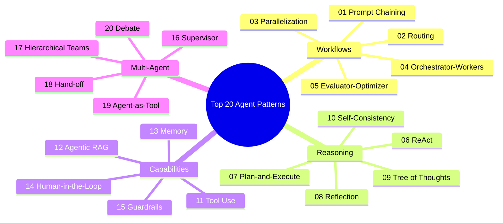

# Top 20 AI Agent Design Patterns: Architecture & Implementation Blueprint

Based on the 4x5 taxonomy: **Workflows** &rarr; **Reasoning** &rarr; **Capabilities** &rarr; **Multi-Agent**.

---

## 1. High-Level Taxonomy Overview

---

## 2. Detailed Breakdown of the 20 Patterns

### Category 1: Workflows (Rows 01–05)
Deterministic and semi-deterministic structural flows orchestrating one or more prompts.

| # | Pattern Name | Flow / Architecture | Description & Core Mechanism | Ideal Use Cases |
|---|---|---|---|---|
| **01** | **Prompt Chaining** | `in -> LLM -> Gate -> LLM -> out` (fail &rarr; exit) | Breaks a task into fixed sequence steps. An intermediate verification gate checks preconditions/errors before advancing. | Document pipeline: extract facts &rarr; validate structure &rarr; generate report. |
| **02** | **Routing** | `in -> Router -> [LLM A \| LLM B \| LLM C]` | Classifies an incoming input and dispatches it to a dedicated specialized prompt, tool, or fine-tuned model. | Customer service triage: billing vs. tech support vs. sales inquiries. |
| **03** | **Parallelization** | `in -> [LLM 1 \|\| LLM 2 \|\| LLM 3] -> Merge -> out` | Spawns multiple independent subtasks simultaneously, then aggregates/synthesizes results. | Competitive intelligence, multi-perspective reviews, guardrail checking in parallel. |
| **04** | **Orchestrator-Workers** | `in -> Orchestrator -> Dynamic Workers [W1, W2, W?] -> Synth -> out` | A central orchestrator dynamically plans and generates worker sub-agents on the fly based on input complexity. | Multi-file codebase refactoring, complex research with undetermined scope. |
| **05** | **Evaluator-Optimizer** | `in -> Generator -> Draft -> Evaluator -> Feedback (Loop) -> out (Pass)` | Iterative feedback loop: one model creates drafts, an evaluator critiques against criteria until passing a quality bar. | Code writing with test verification, essay polishing against strict rubrics. |

---

### Category 2: Reasoning (Rows 06–10)
Cognitive techniques for guiding the LLM's internal thinking, problem decomposition, and self-correction.

| # | Pattern Name | Flow / Architecture | Description & Core Mechanism | Ideal Use Cases |
|---|---|---|---|---|
| **06** | **ReAct** | `Thought -> Action (Tool Call) -> Observe -> Loop` | Interleaves chain-of-thought reasoning with tool execution. The agent reasons about what to do, acts, reads output, and loops. | Interactive research, database debugging, open-ended problem solving. |
| **07** | **Plan-and-Execute** | `Planner -> Step List -> Executor -> (Replan on failure)` | Decouples high-level macro planning from micro step execution. Reduces wanderlust and drift during long tasks. | Complex migrations, end-to-end data pipelines, multi-step analytical reports. |
| **08** | **Reflection** | `Draft -> Critic (Self/External) -> Revise -> Answer` | The model reviews its own generated output, self-evaluates correctness/tone/safety, and generates a refined version. | Creative writing, legal draft checks, high-precision code generation. |
| **09** | **Tree of Thoughts (ToT)** | `Tree branching -> State evaluation (Score) -> Prune & Search` | Explores a search tree of multiple reasoning branches using algorithms like BFS/DFS, pruning poor paths. | Strategic planning, puzzles, algorithmic design, game playing (e.g. Chess/Sudoku). |
| **10** | **Self-Consistency** | `N Samples in parallel -> Majority Vote / Aggregation` | Samples multiple reasoning paths for the same prompt at non-zero temperature; picks the consensus answer. | Arithmetic problem solving, deterministic logic, high-reliability classification. |

---

### Category 3: Capabilities (Rows 11–15)
Augmenting LLMs with external tools, structured context, long-term memory, human oversight, and safety.

| # | Pattern Name | Flow / Architecture | Description & Core Mechanism | Ideal Use Cases |
|---|---|---|---|---|
| **11** | **Tool Use** | `LLM -> Structured Tool Call (JSON) -> Runner -> Result -> LLM` | Structured function calling. The model decides which tool to call with arguments, your runtime executes it safely. | Calculator, weather APIs, SQL queries, system commands. |
| **12** | **Agentic RAG** | `Agent <-> [Query -> Vector DB -> Chunks -> Rewrite & Retry]` | Active retrieval where the agent dynamically formulates searches, grades relevance, and rewrites queries iteratively. | Complex technical documentation search, multi-hop question answering. |
| **13** | **Memory** | `Short-term (Context buffer) + Long-term (Vector DB / Key-Value)` | Maintains persistent state across conversation turns and sessions. Recalls past user preferences and facts. | Personal assistants, persistent tutoring systems, long-term customer profiles. |
| **14** | **Human-in-the-Loop (HITL)** | `Agent -> Pending Action -> Breakpoint -> Human Approval/Edit -> Resume` | Pauses execution before irreversible or high-stakes actions (money transfer, email, DB drop) until approved. | Financial transactions, production deployments, patient notification systems. |
| **15** | **Guardrails** | `Input Guardrail -> LLM -> Output Guardrail` | Pre- and post-processing safety layers that intercept prompt injections, PII leaks, hallucinations, and policy violations. | Enterprise compliance bots, children-safe applications, privacy-critical systems. |

---

### Category 4: Multi-Agent (Rows 16–20)
Coordination of specialized independent agents communicating via messages, delegation, or direct transfers.

| # | Pattern Name | Flow / Architecture | Description & Core Mechanism | Ideal Use Cases |
|---|---|---|---|---|
| **16** | **Supervisor** | `Supervisor -> routes to [Researcher, Coder, Writer] -> results flow back` | Central manager agent assigns tasks to specialist agents and combines their outputs into a final solution. | Full-stack software engineering (Architect + Frontend + Backend + QA). |
| **17** | **Hierarchical Teams** | `CEO Agent -> Leads (Lead A, Lead B) -> Workers (a1, a2, b1, b2)` | Multi-tiered organizational structure where team leads manage subordinate sub-agents. Isolates context bloat. | Enterprise-scale simulations, enterprise content lifecycle operations. |
| **18** | **Hand-off** | `User -> Agent A (Triage) --handoff--> Agent B (Billing) --handoff--> Agent C` | Active agent surrenders conversation control and hands off session state to another specialist agent completely. | Multi-department support ticketing, specialized e-commerce purchasing. |
| **19** | **Agent-as-Tool** | `Main Agent -> calls Sub-Agent as a Tool -> returns output string` | Encapsulates an entire autonomous agent inside a standard tool function interface. Caller retains full context. | Sub-agent specialized in web scraping or chart rendering called by an executive assistant. |
| **20** | **Debate** | `Agent A <-> Agent B (Argue N Rounds) -> Judge decides verdict` | Two or more agents with opposing stances or perspectives critique each other's arguments before a judge rules. | Medical diagnosis validation, policy analysis, fact checking, investment thesis defense. |

---

## 3. Framework Selection & Comparative Analysis

| Framework | Best Suited Patterns | Pros | Cons |
|---|---|---|---|
| **LangGraph** (Python) | `01 Chaining`, `04 Orchestrator-Workers`, `05 Evaluator-Optimizer`, `07 Plan-and-Execute`, `14 Human-in-the-Loop`, `16 Supervisor` | First-class cyclic graph support, state management, persistence, checkpoints, native HITL interrupt/resume. | Steeper learning curve, graph mental model. |
| **Pydantic AI** | `02 Routing`, `11 Tool Use`, `15 Guardrails` | Type-safe, strict validation with Pydantic, minimal boilerplate, high performance, first-class dependency injection. | Newer ecosystem, less suited for complex multi-agent debate topologies. |
| **OpenAI Agents SDK / Swarm** | `18 Hand-off` | Extremely clean, ergonomic hand-off primitives (`transfer_to_agent`), lightweight, intuitive mental model. | Tailored to OpenAI models (can be adapted with wrappers), lacks complex persistence by default. |
| **CrewAI** | `17 Hierarchical Teams` | Intuitive role-playing abstractions (Role, Goal, Backstory), rich built-in process models (Sequential, Hierarchical). | Harder to debug low-level token loops, opinionated abstractions. |
| **Smolagents** (Hugging Face) | `06 ReAct`, `19 Agent-as-Tool` | CodeAgent executes Python code directly, extremely lightweight, transparent execution logs, great for tool encapsulation. | Limited multi-agent orchestration features. |
| **LlamaIndex** | `12 Agentic RAG`, `13 Memory` | Unrivaled indexing, reranking, hybrid search, document parsing, and agentic query engines. | Can be overly layered for simple non-RAG workflows. |
| **AutoGen** (Microsoft) | `20 Debate` | Unmatched multi-agent conversation topologies, natural group chat dynamics, debate orchestration. | Async debugging complexity, chat-history management can get verbose. |
| **Native Python / Asyncio** | `03 Parallelization`, `08 Reflection`, `09 Tree of Thoughts`, `10 Self-Consistency` | Zero framework magic, crystal clear cognitive algorithm implementation (pure BFS/DFS, voting, async gather). | Requires writing manual parsing if not using helper libraries. |

---

## 4. Full 20-Pattern Framework Allocation Matrix

| Pattern # | Pattern Name | Recommended Framework | Educational Focus / Why This Framework? |
|:---:|---|---|---|
| **01** | Prompt Chaining | **LangGraph** / LangChain | Demonstrates state progression through explicit graph edges with validation gates. |
| **02** | Routing | **Pydantic AI** | Type-safe router model returning structured enum/decision. |
| **03** | Parallelization | **Asyncio + LLM Provider** | Pure concurrency (`asyncio.gather`), fan-out and fan-in merge logic. |
| **04** | Orchestrator-Workers | **LangGraph** | Dynamic map-reduce nodes spawning worker subgraphs on the fly. |
| **05** | Evaluator-Optimizer | **LangGraph** | Classic generator-evaluator cycle loop with threshold termination. |
| **06** | ReAct | **Smolagents** | Clean, visual step-by-step ToolCallingAgent / CodeAgent showing Thought-Action-Observation. |
| **07** | Plan-and-Execute | **LangGraph** | Explicit state with `plan`, `steps_remaining`, `completed_steps`, and replanning edge. |
| **08** | Reflection | **Native Pydantic AI / LangChain** | Two-pass generator and critic loop refining the final answer. |
| **09** | Tree of Thoughts | **Python Algorithmic Search (BFS/MCTS)** | Clear tree generation, step evaluation scoring, and pruning logic. |
| **10** | Self-Consistency | **Native Asyncio / LangChain** | Parallel sampling at temperature > 0 with majority voting aggregator. |
| **11** | Tool Use | **Pydantic AI** | Cleanest type-safe tool definition with Pydantic argument schemas. |
| **12** | Agentic RAG | **LlamaIndex** | Autonomous query routing, self-correction, and document retrieval. |
| **13** | Memory | **LlamaIndex / LangGraph** | Dual-tier memory: short-term window buffer + persistent ChromaDB / SQLite. |
| **14** | Human-in-the-Loop | **LangGraph** | Native graph interrupts (`interrupt()`), state inspection, approval/edit, and resume. |
| **15** | Guardrails | **NeMo Guardrails / Pydantic AI** | Pre-flight jailbreak/injection filter + post-flight PII masking and schema check. |
| **16** | Supervisor | **LangGraph** | Central supervisor node routing to worker nodes and collating replies. |
| **17** | Hierarchical Teams | **CrewAI** | Hierarchical crew with designated Manager Agent orchestrating sub-teams. |
| **18** | Hand-off | **OpenAI Agents SDK / Swarm** | Idiomatic triage &rarr; specialist hand-off with context transfer. |
| **19** | Agent-as-Tool | **Smolagents / LangGraph** | Sub-agent wrapped inside a tool callable by the root agent. |
| **20** | Debate | **AutoGen** | Two debating agents and an impartial adjudicator judge. |

